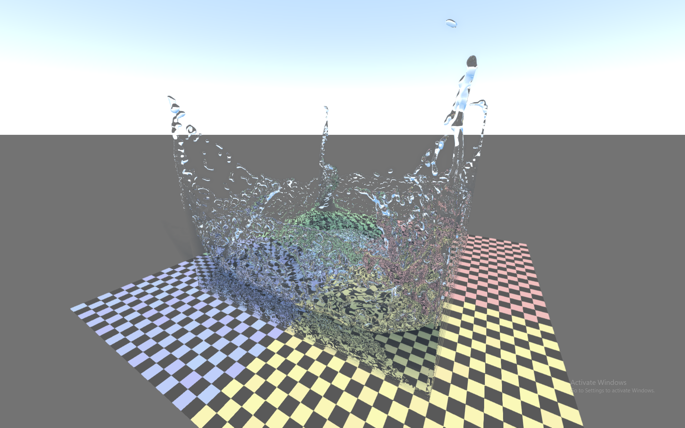
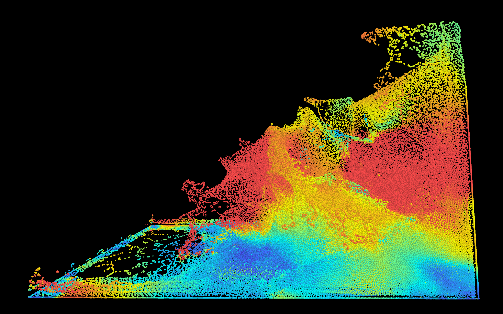
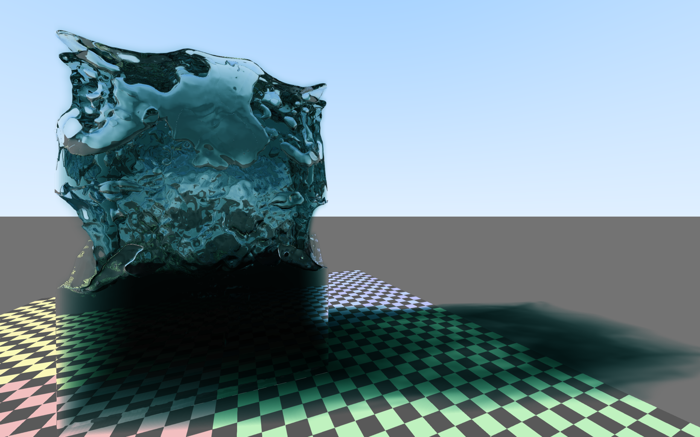
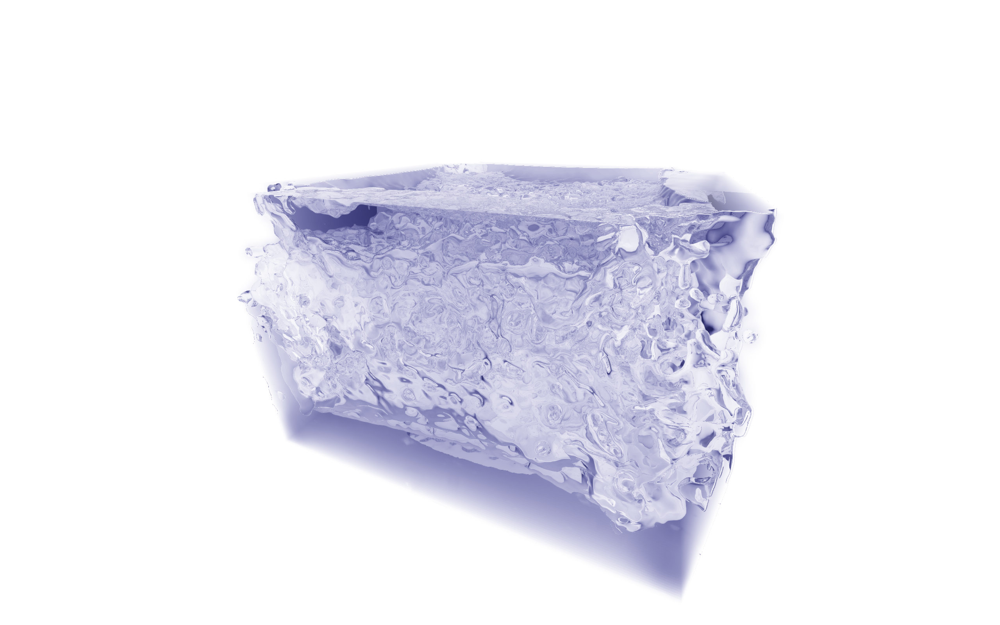

# Particle Fluid Simulation
A fluid simulation, using the SPH (Smoothed Particle Hydronamics) technique.

## Build
Update the GCC path inside the `build.bat` or `build.sh`. The current script assumes GCC is installed at `C:/mysys64/ucrt/bin/gcc.exe`. You must also pass in the CMake files for GLFW inside the script, which currently assumes are at `C:/glfw-mingw/lib/cmake/glfw3`. Then, call either `build.bat` or `build.sh` at the root level.

## Features
You can press B or scroll to switch between Rasterization and Ray Tracing mode. Below is an example of a rasterized scene. The color indicates speed - red, yellow, cyan, and blue correlate to fast, quick, slow, and really slow.

## Implementation
Unlike Eulerian fluid simulations (check out my implementation for that [here](https://github.com/mojofill/smoke-simulation)), Smoothed Particle Hydrodynamics uses particles to simulate fluids. However, simulating every single fluid molecule is obviously too much computation. SPH solves this by using a finite set of particles, and gives it an **influence** radius around other particles. Finally, we define a **target density** that we want the particles to converge towards. And that's it! If particles are too close together, they push each other away, and if particles are too far from each other, they bring each other together, and the magnitude of that force depends on the distance from each other and by extention that **influence** we mentioned earlier.

## More Cool Images

<figure align="center">
  
  <figcaption>Video of rasterized fluid particles</figcaption>
</figure>

## Plans for the Future
I want to make a fully path traced scene of a lake in the woods on a cloudy day, and animate it using this fluid simulation.

## Contact
If you want to hear more about what I'm working on, reach out to me at [LinkedIn](https://www.linkedin.com/in/henryzhang9000/).
